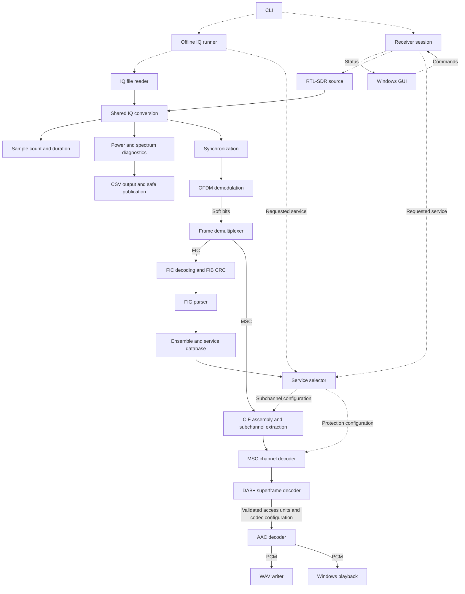

# Receiver architecture

Target: Windows, C++20, DAB+ Mode I, manual tuning, one selected audio service.
This is the intended architecture, not a claim that every component exists.
Implement it incrementally according to the roadmap; keep the backend independent
of the CLI and GUI.

## Components and connections

Solid arrows show data flow; dashed arrows show control or ownership.
The offline runner owns the file-processing loop. The receiver session owns
live acquisition, processing, selection, and shutdown. Both use the same backend.

IQ conversion may execute inside each source; it need not be a separate runtime
stage. Summary and diagnostics are optional consumers, not prerequisites for
decoding. Synchronization supplies timing and frequency estimates to OFDM
processing. The service database accumulates metadata; the selector resolves
one supported service. DAB+ superframe processing handles alignment,
Reed-Solomon correction, and access-unit validation before AAC decoding.

## Reusable building blocks

| Building block | Consumers |
| --- | --- |
| IQ byte conversion | File and RTL-SDR sources |
| Complex operations, correlation, power accumulation | Synchronization, OFDM, diagnostics |
| Frequency rotator and FFT adapter | Synchronization, OFDM; FFT also serves spectrum diagnostics |
| Carrier permutation and soft-bit conventions | OFDM and channel-decoder boundaries |
| Depuncturing, Viterbi adapter, energy-dispersal removal | FIC and MSC, with independent configuration and state |
| Bounded bit reading, bit packing, CRC/fire-code checks | Metadata and transport decoding, using their specified conventions |
| Reed-Solomon and AAC adapters | DAB+ transport and audio decoding, respectively |
| Bounded accumulation buffers and diagnostic records | Stateful processing stages |

## Implementation rules

- Phase 4: file input, conversion, offline runner, summary, diagnostics, CSV.
  Phases 5-8 add synchronization, services, transport decoding, and WAV audio.
  Live input/playback and GUI follow in Phases 10-11.
- Start with synchronous offline processing. Add bounded queues only where live
  acquisition or playback requires thread boundaries.
- Keep processing separate from console formatting and output-file publication.
- Document units, sample/carrier/bit order, soft-bit signs, ownership, and startup
  behaviour at each interface. Use spans for borrowed synchronous input and owned
  buffers for retained or queued data.
- Each stateful component owns its history. Retuning resets ensemble and audio
  state; service changes reset the selected-service path. IQ discontinuities
  invalidate continuity-dependent history and trigger lock confirmation/recovery.
- Cite authoritative specifications beside standard constants and tables. Verify
  primitives independently, then test chunk boundaries, resets, and the reference
  recording. Preserve intermediate diagnostics.
- Extract shared operations when needed. Avoid speculative classes, frameworks,
  or one CMake library per algorithm. The Phase 4 direct DFT is provisional;
  production OFDM and spectrum diagnostics should eventually share an FFT adapter.
